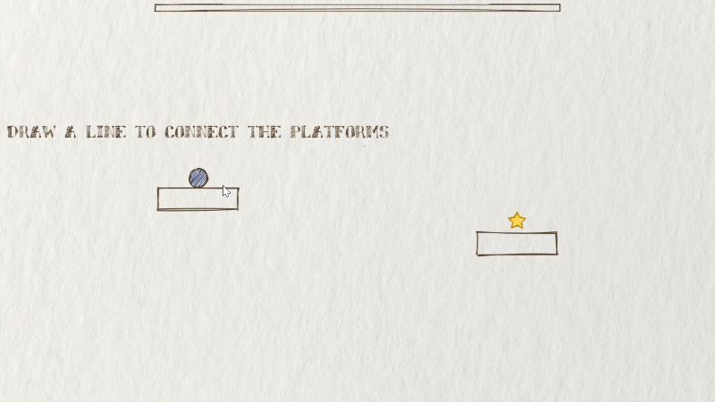
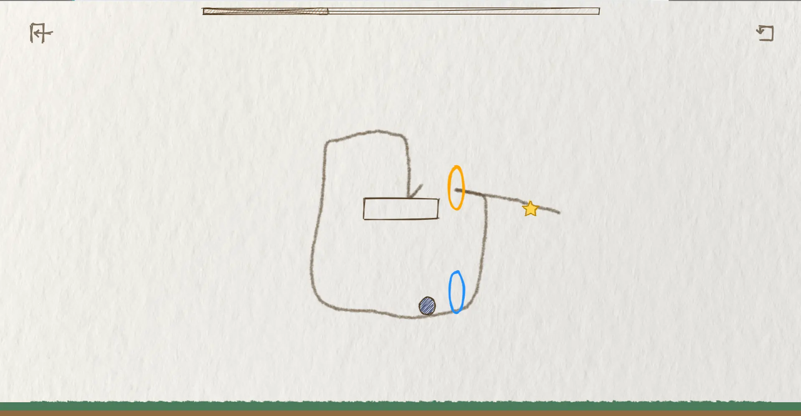
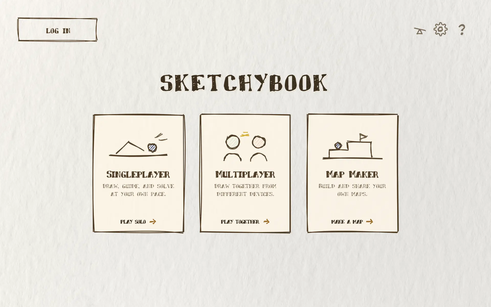
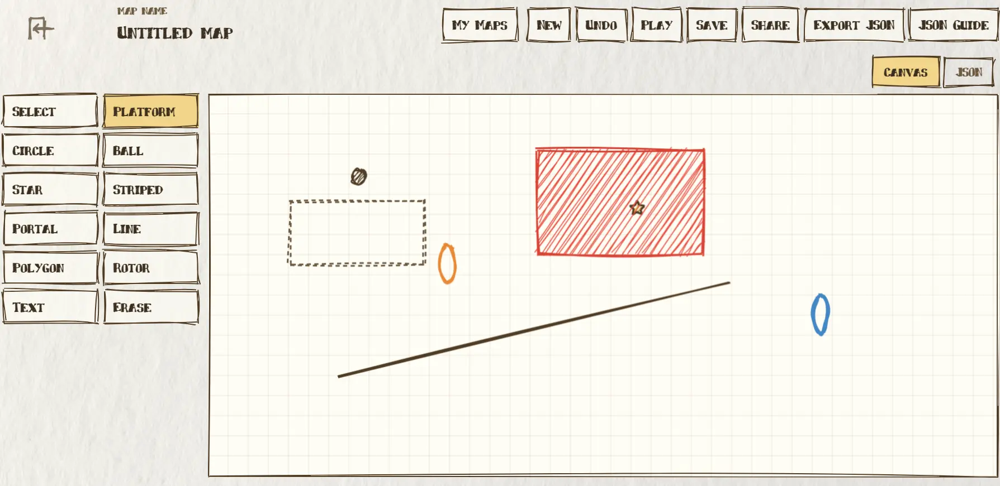

# Sketchybook

### Draw a path. Set the ball in motion. Collect every star.

An interactive physics puzzle book, drawn one line at a time.

 

 

[Gameplay](#gameplay) · [Features](#inside-the-sketchbook) · [Developer guide](#for-developers) · [Documentation](#documentation)

---

## Gameplay

Every stage is a small physics puzzle: study the scene, sketch a route, then launch the ball and see what happens. Collect the star, learn from a failed attempt, and redraw your solution.

	

1. **Sketch** a line to connect platforms or shape a route.
2. **Launch** the ball and let physics take over.
3. **Collect** the star and clear the stage.

## Inside the sketchbook

- **Solo play** across 18 hand-drawn stages.
- **Four difficulty levels**, with different drawing rules and constraints.
- **Challenge mode** for an extra layer of difficulty where available.
- **Multiplayer** for drawing together from different devices.
- **Map Maker** to build, save, share, and play custom maps.
- **Desktop and mobile-friendly controls** for mouse, touch, and keyboard.

<table>
	<tr>
		<td align="center" width="50%">
			 
			<strong>Three ways to play</strong> 
			Solo puzzles, multiplayer drawing, or make your own map.
		</td>
		<td align="center" width="50%">
			 
			<strong>Make a map</strong> 
			Place objects, shape a puzzle, then save or share it.
		</td>
	</tr>
</table>

## Controls

| Action | Desktop | Touch |
| --- | --- | --- |
| Draw a guide line | Click and drag | Drag |
| Launch the ball | Click / tap the ball, or press `Space` | Tap the ball or launch button |
| Retry the stage | Press `R` | Use the retry button |

## Difficulty

| Level | What changes |
| --- | --- |
| Easy | A forgiving introduction with fewer drawing restrictions. |
| Normal | The balanced default ruleset. |
| Hard | Tighter drawing limits and additional constraints. |
| Insane | The strictest rules and most demanding puzzles. |

Challenge mode adds extra constraints on supported difficulties.

## For developers

Setting up the project, running tests, or building the desktop app? Start with the [Developer Guide](docs/DEVELOPER_GUIDE.md).

## Built with

**Vite** · **JavaScript** · **Matter.js** · **Planck.js** · **Rough.js** · **Cloudflare Workers**

## Documentation

- [Developer guide](docs/DEVELOPER_GUIDE.md)
- [Architecture](docs/ARCHITECTURE.md)
- [Code structure](docs/CODE_STRUCTURE.md)
- [Development notes](docs/DEVELOPMENT.md)
- [Deployment](docs/DEPLOYMENT.md)
- [Game objects](docs/OBJECTS.md)
- [Difficulty system](docs/DIFFICULTY_SYSTEM_BRIEFING.md)
- [Project todo](docs/todo.txt)

## License

MIT
